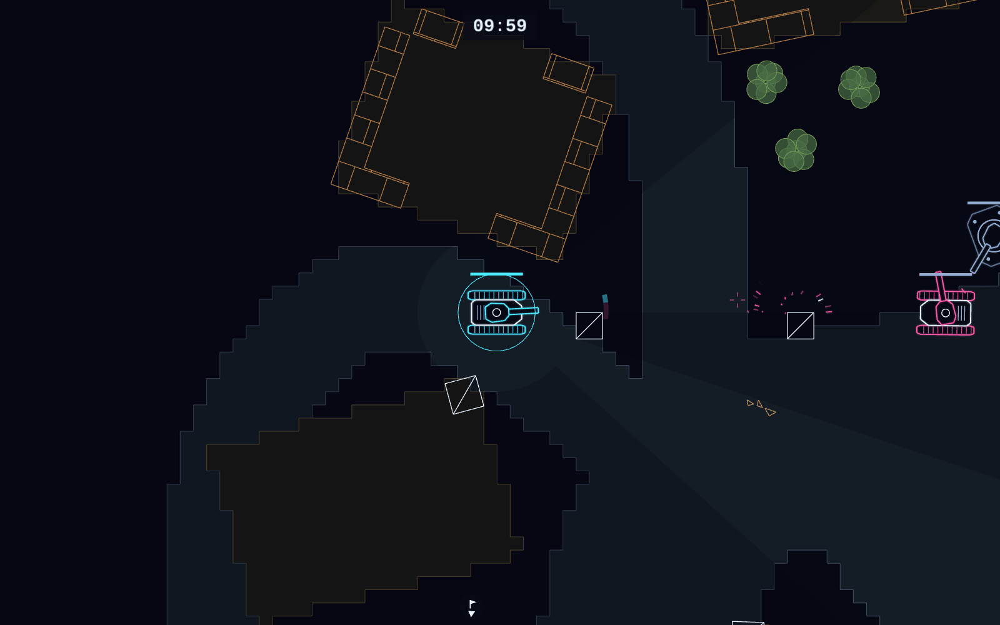
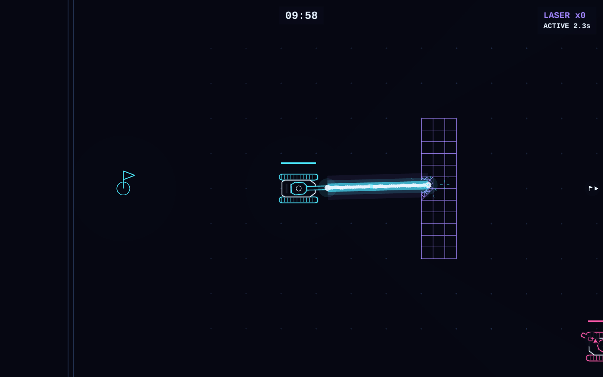
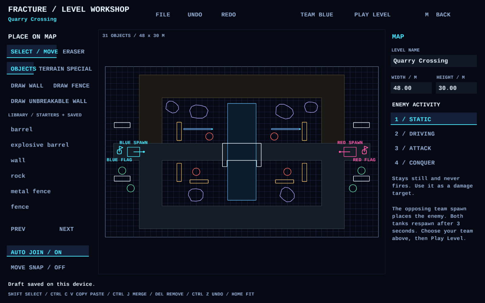

# Fracture

**Tank combat where you can break a path through the battlefield.**

Blast holes in walls, bring down bridges, and fight through the rubble to reach
the enemy flag. Pick a scout car, tank, or mortar carrier and play against the AI
or friends on your local network.

[**Download the latest release**](https://github.com/generall/fracture/releases/latest)
for Linux, Steam Deck, or macOS.

[**Watch the trailer (25 seconds)**](docs/videos/fracture-trailer.mp4)

*Trade shots around village cover.*

## Start playing

- **Linux:** extract the Linux package and run `fracture.sh`. Run `install.sh` to
  add Fracture to your application menu.
- **Steam Deck:** extract the Deck package in Desktop Mode and run `install.sh`.
  Add the installed `fracture-deck.sh` as a non-Steam game, select the **Gamepad**
  controller template, and launch from Gaming Mode. Leave Proton disabled.
- **macOS:** choose the Apple Silicon or Intel package, extract it, and drag
  **Fracture.app** to Applications.

See the [installation guide](docs/RELEASING.md) for requirements and help opening
the macOS app.

For your first match, choose **Enter Local Lobby**, pick **River Valley** or
**Classic Tanks 2**, select your team and match length, then choose **Start Match**.

## Reach their flag. Protect yours.

Touch the enemy flag to win—there is no return trip carrying it home. If your
vehicle is destroyed, choose another and return after the respawn delay. The
battlefield stays damaged, so a breach you opened can become the next attack route.
Timed matches end in a draw if neither team reaches the enemy flag.

Choose a vehicle at the start and whenever you respawn:

| Vehicle | Play style |
| --- | --- |
| **Scout car** | Fast and lightly armored, with all-around vision and a rapid-fire gun for fighting vehicles. Scout routes and make a dash for the flag. |
| **Tank** | A rotating turret, explosive and armor-piercing shells, and access to special weapons. Break through cover or hold a crossing. |
| **Mortar carrier** | Slow and heavily armored, with arcing shells that pass over cover. Stop to tighten your aim before firing. |

The map gives you more choices than a straight shootout:

- **Change the routes.** Break walls, push through loose debris, or collapse a
  bridge to cut off a crossing. A ruined bridge can be repaired and reopened.
- **Choose your ground.** Roads help you move quickly, sand slows you down, and
  tall grass can conceal your approach. Solid cover blocks sight and direct fire.
- **Watch what you reveal.** Fog of war hides enemy movement. Firing from grass
  gives away your position, so choose when to attack.
- **Find extra firepower.** Collect rockets, cutting lasers, plasma cannons, or
  mines. The tank can carry special weapons; the scout relies on its own gun.

Read the [game guide](docs/GAME_MODE.md) or [weapons guide](docs/AMMUNITION.md)
for more about vehicles, combat, and pickups.

*Cut through cover with a collected laser.*

## Play with friends

Desktop LAN matches support up to **six players**. Choose **Play on local network**;
one player hosts, and the others join the discovered lobby or enter the host's
address. Pick teams, ready up, and let the host start the match.

Play on the same local network; internet matchmaking is not available.
See the [multiplayer guide](docs/LAN_MULTIPLAYER.md) for connection help.

## Controls

| Action | Keyboard / mouse | Gamepad / Steam Deck |
| --- | --- | --- |
| Drive and steer | W / A / S / D | Left stick |
| Aim | Mouse | Right stick |
| Fire main weapon | Left click / Space / F | RT |
| Change tank ammunition | B or 5 / 6 | RB |
| Use special weapon | G / right click | LT |
| Match menu | Esc | Menu / Start |
| Show help | H | X |
| Sound settings | F7 | Y |

With the tank, **Q / E** or **J / K** also rotate the turret. With the mortar,
these keys adjust firing range; on a controller, hold the right stick up or down
to adjust range and release it to keep your aim.

See [Steam Deck and controller controls](docs/STEAM_DECK.md) for menu navigation
and handheld tips.

## Make your own battlefield

Every package includes a separate **sandbox** for trying weapons, experimenting
with destruction, and building maps. On Linux or Deck, launch `sandbox.sh`;
on macOS, open **Fracture Sandbox.app**.

*Build your own routes and crossings in the map editor.*

Open **M / Level Editor** to lay out roads, rivers, bridges, cover, weapon pickups,
spawns, and flags. Playtest as either team, then export your map and use
**Import Map** in the game lobby to play it. The object editor lets you create
and test your own walls, rocks, barrels, and other destructible scenery.

Start with the [map editor guide](docs/LEVEL_EDITOR.md) or
[object editor guide](docs/EDITOR.md). Editors work best with a mouse or Deck trackpad.

Building from source or contributing? See [CONTRIBUTING.md](CONTRIBUTING.md) and
the [local release guide](docs/RELEASING.md).
