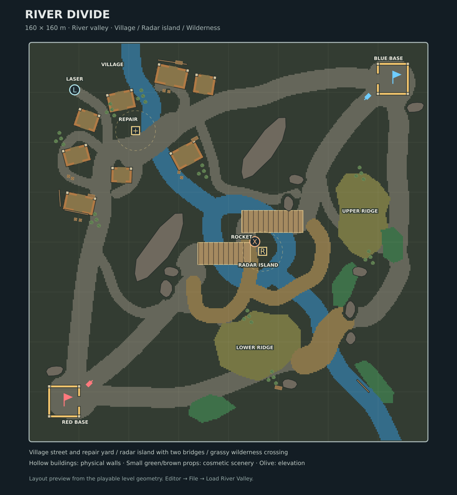

# River Divide / River Valley

Choose **Level Editor → File → Load River Valley**, select a team, and **Play Level**. Loading the map is undoable. The file is also available at [`levels/river-divide.json`](../levels/river-divide.json). Press **V** during play to review it without fog.

The 160 × 160 m map follows the approved valley proposal: opposite-corner bases, a diagonal river, a northwest village, a central radar island, and elevated grassy terrain to the southeast. Curved streets and tracks follow the landscape; shorter connecting tracks let tanks switch routes on either bank.

- **Village:** eight houses, barns, a store and workshop arranged around connected streets and yards. Each has a hollow interior, two 3.5 m entrances and destructible masonry. Small foundation corners support the walls. The repair yard sits beside the permanent river crossing; a side street leads to the laser depot.
- **Middle:** rock ridges separate approaches to the radar island. Two wide destructible bridges provide fast, exposed access. Longer, winding sand approaches connect both banks to the island even if both bridges are destroyed. The rocket pickup sits on permanent dry island ground between the bridge approaches, where both teams can contest it. The radar building sits off the driving line.
- **Bases:** both flags sit inside matching 12 × 12 m destructible wall compounds, rotated to face the opposing team. Each has a 4 m gate and small unbreakable corner foundations. Tanks spawn outside the compounds.
- **Wilderness:** raised firing positions, grass along field margins, breakable fences, and a broad permanent river crossing. Connecting tracks provide shorter but more exposed approaches across the hills. Roads curve around the rock ridges, with clear shoulders along rock edges.
- **Scenery:** shrubs around gardens and field margins, crates in service yards, and stacked timber by barns. These are non-blocking cosmetic props, with no physics bodies or collision response. Tank contact, shells, laser fire and unshielded blasts remove them with short leaf, splinter and dust effects. Effects create no rigid-body debris.

| Objective | Settings |
| --- | --- |
| Repair station | Neutral; 7 s capture; 8 m capture/healing radius; 8 HP/s |
| Radar station | Neutral; 7 s capture; 8 m capture radius; 30 m radar radius |
| Laser and rocket | One pad each; 60 s respawn |

Enemy-owned stations take two capture stages. Settings remain editable through the inspector. Current playtests still use one tank per team; base clearings and routes reserve space for three. Combat balance and six-tank performance need player testing.

## Editing and regeneration

Decorative props are under **Objects → library**, on the second page as **DECOR / SHRUB**, **DECOR / CRATE**, and **DECOR / TIMBER**. They can be moved, rotated, resized, copied and saved like objects. Erasing any part removes the entire prop. They do not join or carve physical walls, and they do not obstruct sight. Fog preserves their last observed state until the player sees the location again; unseen destruction does not update memory.

The map stores terrain in a half-metre mask. Use terrain brushes, rectangle painting and the eraser to edit it; terrain does not consume object slots. The map has 116 objects, including 48 cosmetic props, and about 5,000 material cells. The limit remains 192 objects and 8,192 physics pieces.

Regenerate with `cargo run --release --locked -p sim --example river_divide`. This checks JSON round-tripping, both team spawns, bridge banks, dry pickup locations and stability at rest before saving. Add `-- --drive` for real-physics driving checks through four routes. `--route=village`, `--route=radar`, `--route=highlands` and `--route=sand` restrict that check to one route. The sand check removes both bridges, drives onto the island and across the rocket pad, then follows the other bank's sand approach and enters the enemy flag compound through its gate.
